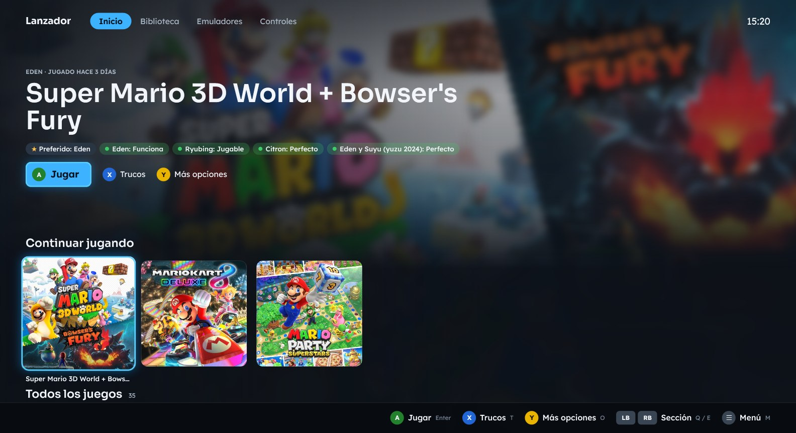
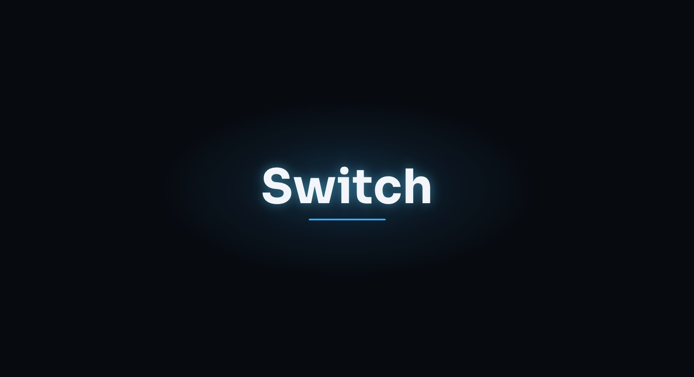
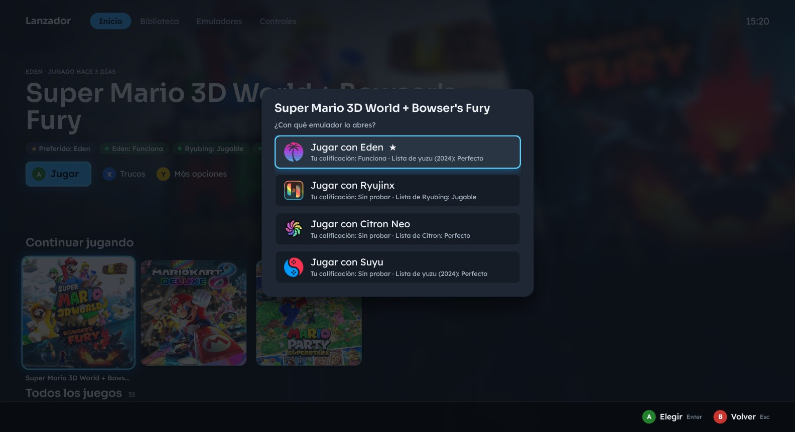
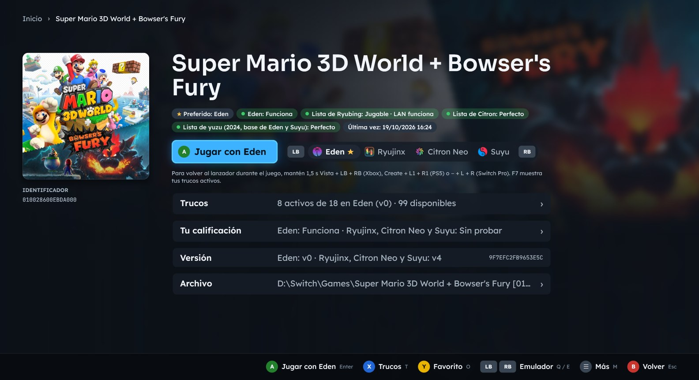
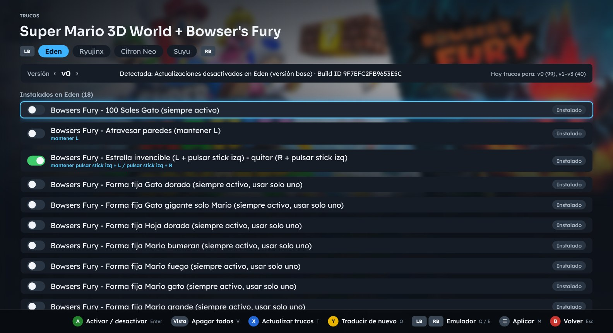
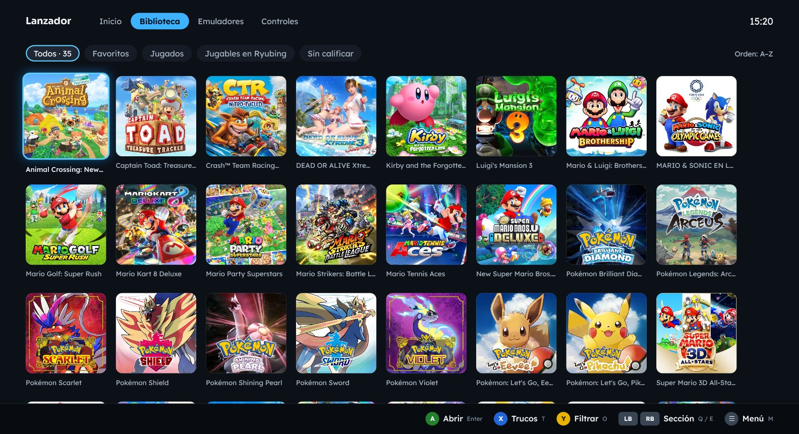
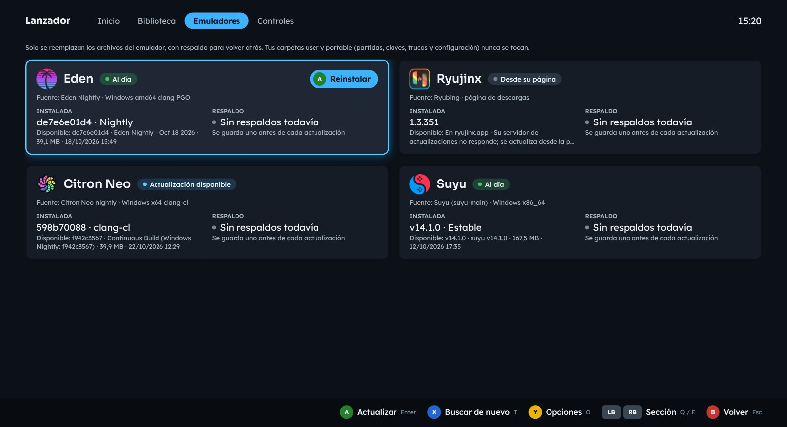
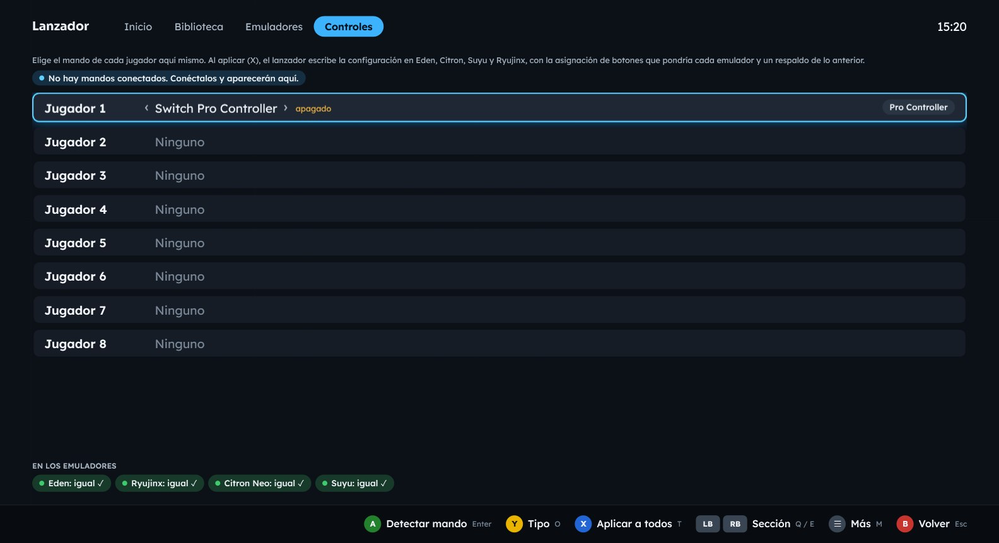
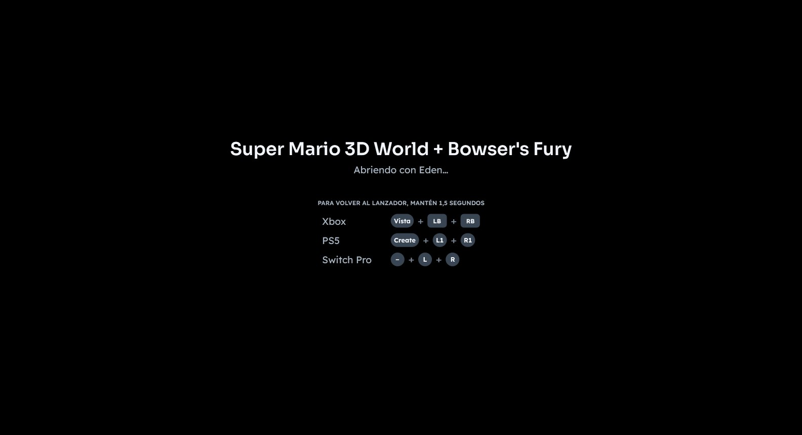
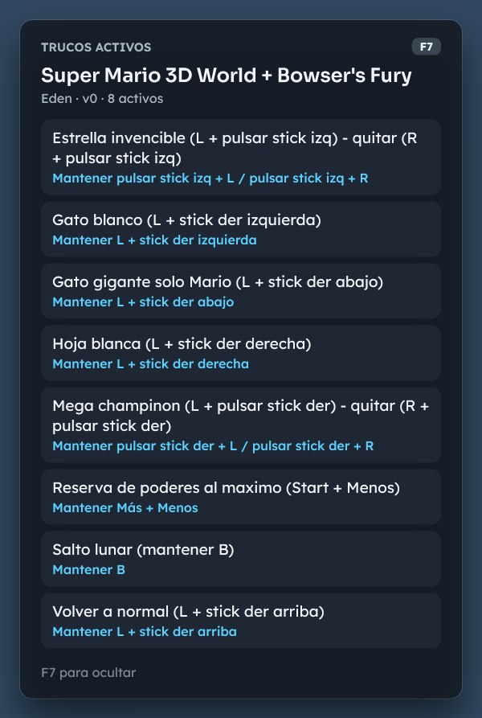

<p align="center"></p>

# Lanzador Switch

Lanzador estilo Big Picture para Windows que abre tus juegos de Switch con **Eden**, **Ryujinx**, **Citron Neo** o **Suyu**, todo con el mando: compatibilidad de cada juego, trucos en español según la versión que usas, actualización de los emuladores con respaldo, y mandos configurados una sola vez para todos los emuladores (hasta 8 jugadores).



## Qué hace

- **Biblioteca** con carátulas y fondos, filas de «Continuar jugando» y Favoritos, filtros y página de cada juego.
- **Elegir emulador** en cada partida, con tu calificación y las listas de compatibilidad de Ryubing, Citron Neo y yuzu.
- **Trucos** de switch-cheats-db y tinfoil.io para la versión exacta del juego (por Build ID), con nombres en español (traducción opcional con Claude Code o Codex) y el botón de cada truco. Durante el juego, **F7** muestra los trucos activos sin quitarle el foco al emulador.
- **Emuladores:** muestra la versión instalada y la publicada, y los actualiza en su sitio verificando el sha256, con respaldo para volver atrás. Nunca toca las carpetas `user` ni `portable`.
- **Controles:** eliges el mando de cada jugador en el lanzador y se escribe en Eden, Citron, Suyu y Ryujinx.
- **Volver al lanzador** desde el juego manteniendo Vista + LB + RB (Xbox), Create + L1 + R1 (PS5) o − + L + R (Pro Controller).

## Descarga e instalación

1. Descarga `LanzadorSwitch-<versión>-win-x64.zip` de la [última versión](https://github.com/corpjorge/lanzador-switch/releases/latest).
2. Opcional: comprueba que llegó completo comparando su hash con `SHA256SUMS.txt`:
   ```powershell
   Get-FileHash .\LanzadorSwitch-1.0.0-win-x64.zip -Algorithm SHA256
   ```
3. Descomprímelo en la carpeta donde tienes los emuladores, por ejemplo `C:\Switch`. Queda `C:\Switch\Lanzador\Lanzador.exe`, y el lanzador busca Eden, Ryujinx, Citron Neo y Suyu en `C:\Switch`.
4. Abre `Lanzador.exe`. El ejecutable no está firmado, así que la primera vez Windows SmartScreen puede mostrar «Windows protegió su PC»: pulsa **Más información → Ejecutar de todas formas**.

Es portable: no necesita instalar .NET ni nada más, y guarda su configuración en la carpeta `datos`, junto al ejecutable. Para quitarlo, borra la carpeta. No lo descomprimas en `Archivos de programa`, porque ahí no podría guardar sus datos.

## Requisitos

- Windows 10 u 11 de 64 bits.
- Al menos un emulador: Eden, Ryujinx (Ryubing), Citron Neo o Suyu. Eden, Citron Neo y Suyu también se pueden instalar desde la sección Emuladores.
- Tus juegos, claves y firmware, sacados de tu propia consola. **El lanzador no los incluye, no los descarga y no los instala.**
- Un mando Xbox, PlayStation, Pro Controller o compatible (también se maneja con el teclado).
- Opcional: [Claude Code](https://claude.com/claude-code) o Codex para traducir los nombres de los trucos.

## Uso básico

| Mando | Teclado | Qué hace |
|---|---|---|
| LB / RB | Q / E | Cambiar de sección: Inicio, Biblioteca, Emuladores, Controles |
| A | Enter | Jugar (pregunta con qué emulador; el preferido va primero) |
| X | T | Trucos del juego |
| Y | O | Página del juego / opciones |
| ☰ | M | Menú: configuración, volver a buscar juegos, pantalla completa, salir |
| B | Esc | Volver |
| — | F7 | Durante el juego: mostrar u ocultar los trucos activos |

La primera vez revisa **☰ → Configuración**: las rutas de los emuladores y las carpetas de juegos se detectan solas, pero puedes cambiarlas. La guía completa, con cómo funciona cada parte, está en [LEEME.md](LEEME.md).

## Cómo se ve

| | |
|---|---|
| <br>**Intro** al abrir, con su sonido (se salta con cualquier botón). | <br>**A** pregunta con qué emulador; el preferido va primero. |
| <br>**Página del juego**: emulador con LB / RB, trucos, calificación, versión y archivo. | <br>**Trucos** de tu versión, en español; Vista apaga todos o enciende los de antes. |
| <br>**Biblioteca** en cuadrícula, con filtros (Y). | <br>**Emuladores**: versión instalada y publicada, actualización y respaldo. |
| <br>**Controles** para hasta 8 jugadores, escritos en todos los emuladores. | <br>Al abrir un juego: **cómo volver** al lanzador con cada mando. |

<p align="center"><br><b>F7</b> durante el juego: ventana flotante con los trucos activos y sus botones.</p>

## Compilar

Necesitas Windows y el [SDK de .NET 10](https://dotnet.microsoft.com/download/dotnet/10.0).

```powershell
dotnet build Lanzador.slnx -c Release
dotnet run --project src\Lanzador.Pruebas         # pruebas del núcleo (leen tu instalación, no la modifican)
dotnet publish src\Lanzador.App -c Release -o app  # el lanzador en app\Lanzador.exe
pwsh herramientas\empaquetar.ps1                   # ZIP portable y SHA256SUMS.txt en publicar\
```

El código está en `src\Lanzador.Core` (núcleo), `src\Lanzador.App` (interfaz WPF) y `src\Lanzador.Pruebas` (pruebas).

Los paquetes de cada versión los arma GitHub Actions desde este repositorio ([`compilar.yml`](.github/workflows/compilar.yml)).

## Política de firma de código (Code signing policy)

Free code signing provided by [SignPath.io](https://about.signpath.io), certificate by [SignPath Foundation](https://signpath.org). La firma está pendiente de aprobación: hasta entonces los paquetes no van firmados. Qué se firma, quién lo aprueba y a qué servicios se conecta el lanzador: [POLITICA-DE-FIRMA.md](POLITICA-DE-FIRMA.md).

## Licencia

[MIT](LICENSE). Los componentes de terceros (SDL3, fuentes Sora, Lexend y JetBrains Mono, .NET) tienen sus propias licencias: ver [THIRD-PARTY-NOTICES.md](THIRD-PARTY-NOTICES.md).

Este proyecto no está afiliado a Nintendo ni a los proyectos de los emuladores. Nintendo Switch es una marca de Nintendo. Las carátulas que aparecen en las capturas son de sus dueños: el lanzador las descarga de tinfoil.media en tu equipo y no se distribuyen con él.
